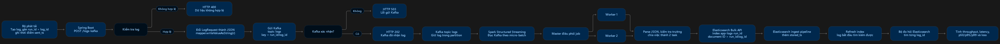

# Baseline: Spring Boot -> PostgreSQL

Giải nén bộ này vào thư mục repo DO_AN_BIGDATA, cạnh file docker-compose.

```
DO_AN_BIGDATA/
  docker-compose.yml        (bản sao của docker-compose_new.yml)
  init/01-schema.sql        bảng app_log
  app/                      Spring Boot baseline (POST /logs, POST /noop, GET /clock)
  loadgen/LoadGen.java      bộ bắn tải, chạy thẳng bằng java, không cần build
  loadgen/apache_500k.jsonl.gz (dataset nén, LoadGen đọc thẳng)
  metrics.sql               tính tỉ lệ mất log, throughput, p50/p95/p99
```

## Lệnh (PowerShell, đứng ở thư mục repo)

```powershell
cd $HOME\DO_AN_BIGDATA                           # docker-compose.yml đã có sẵn
docker compose up -d                              # bật PostgreSQL
docker exec -it la-postgres psql -U loguser -d logdb -c "\d app_log"
docker compose --profile app up -d --build        # bật app (lần đầu mất vài phút)
curl.exe http://localhost:8085/clock              # phải ra {"db_ms":...}
docker cp metrics.sql la-postgres:/metrics.sql    # chép file đo vào container, 1 lần

cd loadgen
# kiểm tra máy bắn tải (không ghi DB)
java LoadGen.java --file apache_500k.jsonl.gz --rate 10000 --duration 30 --run-id noop-10000 --path /noop
# 1 lần đo thật (90 giây = 30 giây khởi động + 60 giây đo)
docker exec -it la-postgres psql -U loguser -d logdb -c "TRUNCATE app_log"
java LoadGen.java --file apache_500k.jsonl.gz --rate 1000 --run-id pg-1000-r1
docker exec -it la-postgres psql -U loguser -d logdb -v run=pg-1000-r1 -v rate=1000 -f /metrics.sql
```

Mỗi lần chạy dùng một run_id mới. Đo xong rồi mới TRUNCATE trước lần chạy tiếp theo.


## Chạy pipeline Spring Boot → Kafka → Spark → Elasticsearch

### 1. Bật dịch vụ

Mở Docker Desktop, sau đó chạy:

```powershell
docker compose --profile streaming --profile app up -d --build
docker compose ps
```

Đợi Kafka và Elasticsearch hiện `healthy`. Kiểm tra Spring Boot:

```powershell
curl.exe http://localhost:8085/clock
```

Phải nhận được JSON có `db_ms`. Cổng 8085 là cổng của app;

### 2. Chuẩn bị Kafka và Elasticsearch

Chỉ chạy sau khi Kafka và Elasticsearch đã `healthy`:

```powershell
.\spark-jobs\setup_topic.ps1
python .\spark-jobs\setup_es.py
```

### 3. Chạy Spark trên hai worker

Mở **PowerShell thứ hai** tại thư mục gốc repo. Chạy lệnh này và để cửa sổ mở trong lúc đo:

```powershell
docker exec -it la-spark-master /opt/spark/bin/spark-submit `
  --master spark://spark-master:7077 `
  --deploy-mode client `
  --conf spark.driver.host=spark-master `
  --conf spark.driver.bindAddress=0.0.0.0 `
  --conf spark.jars.ivy=/tmp/spark-ivy `
  --conf spark.executor.memoryOverhead=128m `
  --driver-memory 512m `
  --executor-memory 512m `
  --total-executor-cores 2 `
  --packages org.apache.spark:spark-sql-kafka-0-10_2.12:3.5.1 `
  /opt/spark-jobs/logs_to_es.py
```

Mở [http://localhost:8081](http://localhost:8081). Chỉ bắn tải khi application `logs-kafka-to-elasticsearch` là `RUNNING` và cả hai worker là `ALIVE`. 

### 4. Gửi log và xem kết quả

Mở **PowerShell thứ ba**:

```powershell
cd .\loadgen
java .\LoadGen.java --file .\apache_500k.jsonl.gz --rate 1000 --duration 90 --run-id kf-1000-r1 --path /logs-kafka
```

`--duration 90` gồm 30 giây làm nóng và 60 giây đo. Mỗi lượt dùng `run-id` mới. Nếu LoadGen chỉ báo vài log `OK`, hoặc nhiều timeout và log bị bỏ qua, lượt đó chưa tạo được tải 1.000 log/giây.
có thể thay đổi duration để chạy cho đúng với yêu cầu

Khi LoadGen chạy xong, vẫn trong thư mục `loadgen`, tính số đo:

```powershell
python .\metrics_pipeline.py --run-id kf-1000-r1 --rate 1000 --wait-drain
```

Lệnh này đợi Spark xử lý nốt log và Elasticsearch refresh, rồi in kết quả và ghi vào `ket-qua/tong-hop-pipeline.csv`.

- **Throughput:** số log lưu được trong cửa sổ đo chia 60 giây.
- **p50/p95/p99:** thời gian từ lúc tạo log đến lúc Elasticsearch nhận document. Log có thể tìm kiếm được trễ thêm khoảng một giây do refresh.
- **Mất âm thầm:** log Spring trả `202` nhưng không tìm thấy trong Elasticsearch trước hạn chờ.
- **Lỗi thấy được và bỏ qua:** xem tổng kết của LoadGen.

Giữ Spark, Kafka và Elasticsearch chạy trong suốt lượt đo. Chạy từng lượt một, không chạy hai bộ phát tải cùng lúc. Khi đổi tốc độ, đổi `--rate` và dùng `run-id` mới ở cả hai lệnh.

### Nếu gặp lỗi

```powershell
docker compose ps
curl.exe http://localhost:8085/clock
```

Nếu app không phản hồi, kiểm tra container `la-app`. Nếu Spark chưa `RUNNING` hoặc thiếu worker `ALIVE`, chưa bắn tải. Không dùng `local[*]`, vì chế độ đó không gửi tác vụ tới hai worker.

